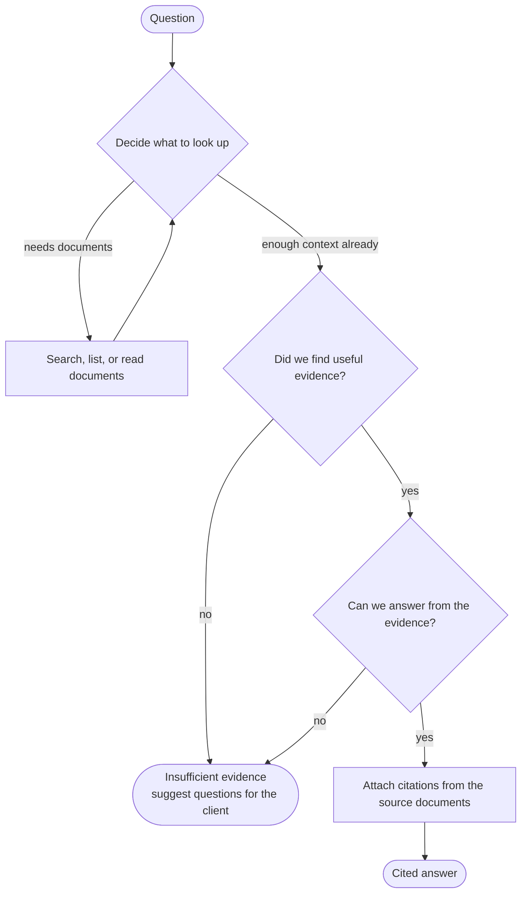

# AIditor

Document-grounded Q&A for auditors. Upload engagement documents, ask questions, and get
cited answers — or suggested client questions when evidence is missing.

**Core deliverable:** a FastAPI + LangGraph RAG HTTP backend (citations, health, validation,
OpenAI or free local Ollama). The CLI and TUI are optional clients over the same API; they are
not required to evaluate the backend.

See [specs/001-audit-assistant-rag/](specs/001-audit-assistant-rag/) for the full specification.

## Workspace

| Path               | Package   | Role                                                                                          |
| ------------------ | --------- | --------------------------------------------------------------------------------------------- |
| `services/backend` | `backend` | Domain, application, infrastructure layers; HTTP API + upload processor; tests under `tests/` |
| `cli`              | `cli`     | `aiditor` non-interactive CLI + shared HTTP client; tests in `cli/tests/`                     |
| `tui`              | `tui`     | `aiditor-tui` fullscreen Textual client; tests in `tui/tests/`                                |

### Docker Compose recipes

| Recipe                                                                                   | Files                                    | Use when                                                                 |
| ---------------------------------------------------------------------------------------- | ---------------------------------------- | ------------------------------------------------------------------------ |
| `just compose-up` / `compose-down` / `compose-restart` / `compose-clean`                 | `deployment/docker-compose/compose.yaml` | Production-like local deploy                                             |
| `just compose-dev-up` / `compose-dev-down` / `compose-dev-restart` / `compose-dev-clean` | `compose.yaml` + `compose.dev.yaml`      | Dev overrides (Postgres `:5432`, readable logs; `/docs` forced on `api`) |

`compose-clean` / `compose-dev-clean` also remove volumes (indexed data is wiped).

Compose services (same app image, different commands — except the load balancer):

| Service            | Role                                                                           |
| ------------------ | ------------------------------------------------------------------------------ |
| `migrate`          | One-shot Alembic `upgrade head`, then exits                                    |
| `api`              | HTTP + ask agent (migrations via `migrate` service); **2 replicas** by default |
| `upload-processor` | Claims upload jobs and indexes documents; **2 replicas** by default            |
| `load-balancer`    | Caddy reverse proxy; host port `8000` → `api:8000`                             |
| `postgres`         | Metadata, sessions, job queue, pgvector                                        |

## Prerequisites

- Docker
- [uv](https://docs.astral.sh/uv/) and [just](https://github.com/casey/just)
- Python 3.13 (for host `uv sync` / CLI / seed)
- Either **host Ollama** (default) or an OpenAI API key

## Local models (Ollama) — default

On the host:

```bash
ollama pull qwen3.5:4b
ollama pull nomic-embed-text
```

Defaults (`deployment/docker-compose/.env.example`):

- `LLM_MODEL=ollama_chat/qwen3.5:4b`
- `EMBEDDING_MODEL=ollama/nomic-embed-text`
- `LLM_API_BASE=http://host.docker.internal:11434`

Containers reach host Ollama via `host.docker.internal`.

### Hardware and limits

| Setup                        | What to expect                                                                                                                                                                                                      |
| ---------------------------- | ------------------------------------------------------------------------------------------------------------------------------------------------------------------------------------------------------------------- |
| **NVIDIA GPU (recommended)** | `qwen3.5:4b` + `nomic-embed-text`; roughly **6–8 GB VRAM** free for comfortable use. Answers in seconds to tens of seconds.                                                                                         |
| **CPU-only**                 | Same models work; expect **minutes** per ask and high RAM use (plan on **16 GB+** system RAM). Prefer a smaller chat model if the machine struggles (e.g. `qwen2.5:3b`) and keep `nomic-embed-text` for embeddings. |
| **Quality**                  | Local mode is slower and less consistent than cloud; still exercises the full RAG path with no paid API key.                                                                                                        |
| **Timeouts**                 | Default `MODEL_TIMEOUT_SECONDS=120`. Raise it on CPU-only hosts if asks time out.                                                                                                                                   |
| **Context**                  | Chat calls set `OLLAMA_NUM_CTX` (default **32768**). If asks return `413 context_too_large`, raise it; if Ollama OOMs, lower it.                                                                                    |

Optional in-compose Ollama (GPU via NVIDIA Container Toolkit):  
`docker compose -f deployment/docker-compose/compose.yaml --profile local up -d` — prefer host Ollama for day-to-day GPU use.

## OpenAI mode

In `deployment/docker-compose/.env`:

```bash
LLM_MODEL=openai/gpt-6-luna
LLM_API_KEY=sk-...
LLM_API_BASE=
EMBEDDING_MODEL=openai/text-embedding-3-small
```

## Run (HTTP-first)

```bash
cp deployment/docker-compose/.env.example deployment/docker-compose/.env
just sync         # uv sync --all-packages (backend + cli + tui)
just compose-up   # migrate → 2× api + 2× upload-processor + load-balancer + postgres
just seed         # creates sample engagements and indexes AI-generated docs
```

For day-to-day coding against published DB ports and readable logs, use `just compose-dev-up` instead.

API base URL: `http://localhost:8000` (via `load-balancer`)  
Interactive docs (enabled by default): [http://localhost:8000/docs](http://localhost:8000/docs)

### Health

```bash
curl -s http://localhost:8000/health/live
curl -s http://localhost:8000/health/ready
```

Live returns `{"status":"ok"}`. Ready includes `postgres` and `embeddings` checks.

### Ask (after `just seed`)

```bash
curl -s -X POST http://localhost:8000/api/v1/engagements/northwind-fy2025/ask \
  -H "Content-Type: application/json" \
  -d "{\"question\": \"What are Contoso payment terms?\"}"
```

Expect `kind: "answered"` with numbered `citations` (e.g. `contracts/contoso-msa.md`).

Insufficient-evidence example:

```bash
curl -s -X POST http://localhost:8000/api/v1/engagements/northwind-fy2025/ask \
  -H "Content-Type: application/json" \
  -d "{\"question\": \"What is the SOC 2 Type II opinion date for Contoso?\"}"
```

Sample engagements and prompts: [docs/samples/ai-generated/README.md](docs/samples/ai-generated/README.md).  
End-to-end scenarios: [specs/001-audit-assistant-rag/quickstart.md](specs/001-audit-assistant-rag/quickstart.md).

### Optional clients

```bash
aiditor-tui                # fullscreen interactive UI
aiditor engagements list   # non-interactive CLI
```

To author a new DB migration after changing SQLAlchemy models: `just migration "describe change"`.  
Compose applies pending revisions via the `migrate` service on the next `compose-up`.

## Quality gate

```bash
just check   # ruff + basedpyright + import-linter + offline pytest (no paid APIs)
```

Integration smoke against a live Ollama (optional): `just test-integration` with `RUN_INTEGRATION=1`.

## Architecture

```text
upload / seed  →  job queue + upload-processor  →  parse → chunk → embed → pgvector
                                              ↓
ask HTTP (via load-balancer)  →  LangGraph  →  cited answer
```

- **`backend.domain`** — frozen pydantic feature models
- **`backend.application`** — Protocols (`llm`, `parsing`, `repositories`, `storage`), services, RAG, HTTP API (controllers), upload-processor entrypoints
- **`backend.infrastructure`** — Postgres/pgvector, LiteLLM chat/embed adapters, local FS, parsing
- **`cli` / `tui`** — HTTP clients only (same contracts as `/docs`)

Chat and embeddings are configured with LiteLLM model ids (`LLM_MODEL` / `EMBEDDING_MODEL`) plus optional API key and base URL; application logic does not change.

### Research agent

When you ask a question, the agent researches the engagement documents, then either
returns a cited answer or explains what is missing and suggests follow-ups for the client.



## Concurrency and scaling

### What this app does today

- **Isolation:** Engagement-scoped data and chat sessions live in Postgres. Ask handlers do not keep mutable per-user state in process memory. Logs carry `request_id` for correlation.
- **Roles:** `api` serves HTTP; `upload-processor` claims ingest jobs with `SELECT … FOR UPDATE SKIP LOCKED`; `migrate` runs once before either starts; `load-balancer` fronts `api`.
- **Shared data:** Postgres (metadata, chunks, jobs) and the `document_storage` volume (raw uploads). Every `api` / `upload-processor` replica must see the same files.
- **Model concurrency:** `MAX_CONCURRENT_MODEL_CALLS` is a **per-process** semaphore (each replica has its own cap).
- **Ask path:** FastAPI async; ingest is off the request path (upload returns `202`, processors index in the background).

`just compose-up` / `just compose-dev-up` start **2 `api` and 2 `upload-processor` replicas**, then restart `load-balancer` so Caddy refreshes Docker DNS upstreams. No sticky sessions are required (session state is in Postgres). Long ask / SSE timeouts are set on the proxy.

To change replica counts:

```bash
docker compose -f deployment/docker-compose/compose.yaml up -d --scale api=3 --scale upload-processor=2
docker compose -f deployment/docker-compose/compose.yaml restart load-balancer
```

### Bottlenecks (in order)

1. **LLM / embeddings** (local Ollama GPU/CPU, or OpenAI rate limits and latency)
2. **Postgres + pgvector** under heavy hybrid search and job claiming
3. Only then more `api` replicas (more concurrent asks) or `upload-processor` replicas (deeper ingest queue)

### Local vs cloud next step

| Concern | Local compose (built)                                | Cloud target                                                                                                                                     |
| ------- | ---------------------------------------------------- | ------------------------------------------------------------------------------------------------------------------------------------------------ |
| HTTP    | `api` behind `load-balancer`                         | Autoscaled Container Apps replicas                                                                                                               |
| Ingest  | Long-lived `upload-processor` (scale with `--scale`) | Same claim/process code; **queue-depth autoscaling** (KEDA / Container Apps Jobs / Service Bus), including scale-to-zero — not one VM per upload |
| Schema  | One-shot `migrate`                                   | Same idea (job/init), not on every replica start                                                                                                 |
| Files   | Shared Docker volume                                 | Blob storage adapter                                                                                                                             |
| Search  | pgvector in Postgres                                 | Often Azure AI Search (independent scale)                                                                                                        |

Details: [deployment/cloud/README.md](deployment/cloud/README.md).

## Cybersecurity

Supply-chain and application controls in place today:

- **Patch-only dependency ranges** — every direct dependency in the workspace `pyproject.toml` files is capped at the next minor (`>=X.Y,<X.(Y+1)`). Patch releases can land; minor/major upgrades require an intentional pin bump.
- **Minimum package release age** — root `[tool.uv] exclude-newer = "7 days"` applies a dependency cooldown so freshly published (and potentially compromised) uploads cannot enter `uv.lock` until they have aged. Requires uv `>=0.9.17`.
- **Locked, reproducible installs** — a single committed `uv.lock` pins the full transitive tree for CI and local sync.
- **Security audit skill** — Cloudflare’s [security-audit-skill](https://github.com/cloudflare/security-audit-skill) is vendored under `.agents/skills/security-audit/` and pinned by commit hash in `skills-lock.json` for agent-led vulnerability reviews.
- **Engagement isolation** — retrieval, document reads, and agent tools are scoped to one engagement id; path types reject `..` and absolute paths.
- **Safe uploads** — zip extraction blocks path escape and symlinks; upload byte/file count caps limit resource exhaustion.
- **Agent bounds** — tool allowlist with engagement-locked context, max tool rounds / check restarts, and prompt/evidence character caps.
- **Secrets handling** — API keys use `SecretStr`; `.env` is gitignored (only `.env.example` is committed).

Local compose still has no application authentication by design for this phase; treat published ports as trusted-network only. See Limitations below.

## Limitations / next steps

- No authentication or user management
- Ask flow is a LangGraph `StateGraph` (tool loop → grade → generate → finalize); a minimal retrieve→generate graph would also satisfy the brief
- Sessions keep the last `SESSION_CONTEXT_TURNS` (default 5) turns verbatim and summarize older turns before Ask; generate prompts also cap evidence via `AGENT_EVIDENCE_MAX_CHARS`. If the provider still rejects the prompt as too large, the API returns `413 context_too_large` (start a new session or shorten the question).
- Chunk sizes not corpus-tuned; OCR out of scope
- Local compose does not autoscale ingest; cloud would scale processors from queue depth
- Cloud mapping: [deployment/cloud/README.md](deployment/cloud/README.md)
