```text
  █████╗ ██╗██████╗ ██╗████████╗ ██████╗ ██████╗
 ██╔══██╗██║██╔══██╗██║╚══██╔══╝██╔═══██╗██╔══██╗
 ███████║██║██║  ██║██║   ██║   ██║   ██║██████╔╝
 ██╔══██║██║██║  ██║██║   ██║   ██║   ██║██╔══██╗
 ██║  ██║██║██████╔╝██║   ██║   ╚██████╔╝██║  ██║
 ╚═╝  ╚═╝╚═════╝ ╚═╝   ╚═╝    ╚═════╝ ╚═╝  ╚═╝
```

Auditálás során segít megbízható, hivatkozott válaszokat adni az auditornak.

Az auditor megbízásonként fel tud tölteni dokumentumokat, majd kérdezni tud egy AI agenttől, ami a forrásokra hivatkozva megbízhatóan választ ad. Ha nem tud megbízható választ adni, akkor ezt jelzi az auditor felé és további forrásokat kér, meg is nevezi mire van szüksége.

## TL;DR

Előfeltétel: Docker, [uv](https://docs.astral.sh/uv/), [just](https://github.com/casey/just), és **host Ollama** (vagy OpenAI kulcs).

```bash
# 0) (Opcionális) Lokális modellek
ollama pull qwen3.5:4b
ollama pull nomic-embed-text

# 1) Stack
cp deployment/docker-compose/.env.example deployment/docker-compose/.env
just compose-dev-up      # migrate → 2× api + 2× upload-processor + Caddy + Postgres
just seed                # fiktív audit minták (northwind / fabrikam / adventureworks)

# 2) Ellenőrzés + kérdés
curl -s http://localhost:8000/health/live
curl -s http://localhost:8000/health/ready
curl -s -X POST http://localhost:8000/api/v1/engagements/northwind-fy2025/ask \
  -H "Content-Type: application/json" \
  -d "{\"question\": \"What are Contoso payment terms?\"}"

# 3) UI
just sync
just tui

# 4) Offline quality gate
just check
```

OpenAPI: [http://localhost:8000/docs](http://localhost:8000/docs)

## Szószedet

| Fogalom          | Magyarázat                                                                                                                                                                                        |
| ---------------- | ------------------------------------------------------------------------------------------------------------------------------------------------------------------------------------------------- |
| Document         | Információt tartalmazó fájl, amit indexelni tud a rendszer. Jelenleg a `.md`, `.markdown`, `.txt`, `.pdf`, `.docx`, `.xlsx`, `.pptx`, `.html`, `.htm`, `.csv` fájlformátumokat tudja feldolgozni. |
| Upload           | Egy `Document` feltöltődik és indexelése.                                                                                                                                                         |
| Upload Processor | Figyeli, hogy van-e feldolgozatlan `Upload`, és ha van, akkor lefoglalja és feldolgozza.                                                                                                          |
| Session          | Egy chat kontextusa.                                                                                                                                                                              |
| Engagement       | Auditálási megbízás. Kontextus szeparációt biztosít a `Document`-ek, `Upload`-ok és `Session`-ök között.                                                                                          |
| Research Agent   | LangGraph állapotgép toolokkal: Engagement dokumentumokból hivatkozott választ ad, vagy hiányzó forrásokat jelez.                                                                                 |

## Hogyan működik?

### Termék

1. Az auditor létrehozza a megbízást.

   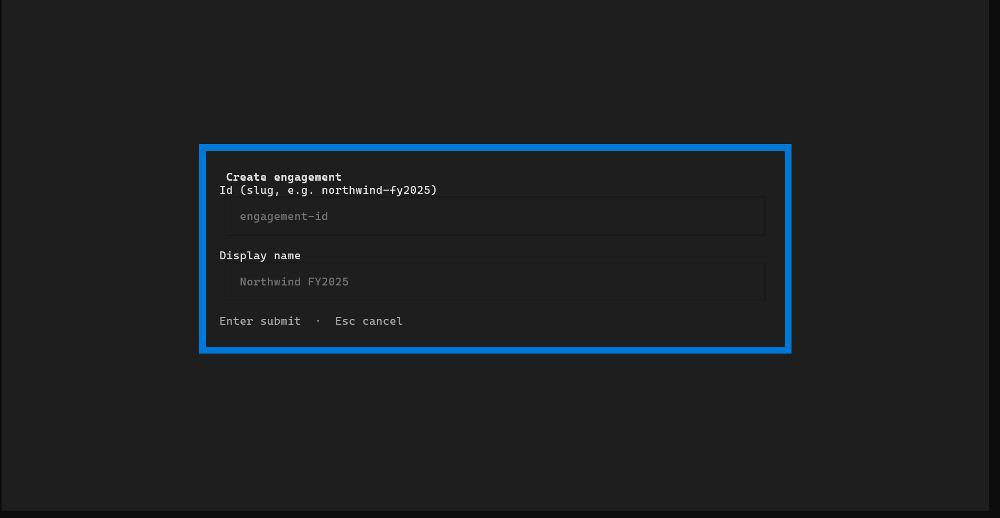

2. Az auditor feltölti a megbízáshoz tartozó dokumentumokat. A rendszer a háttérben feldolgozza őket, és kereshető formában elmenti a megbízás tudásbázisába.

   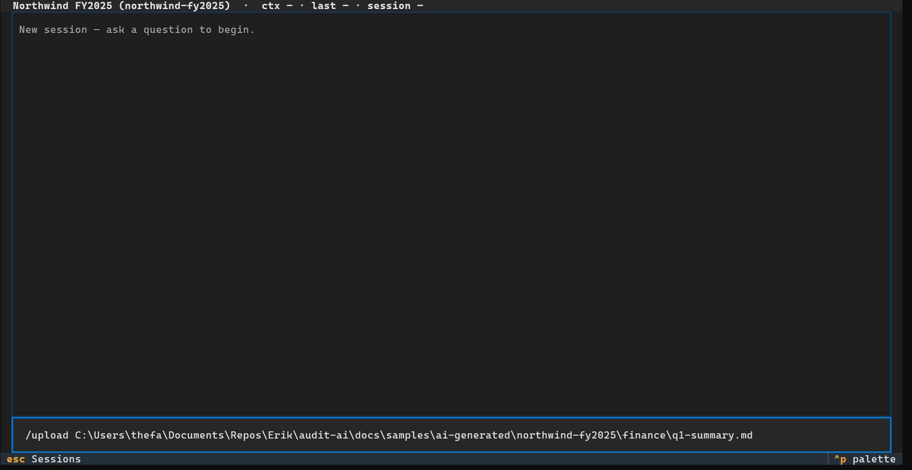

3. Az auditor kérdez a megbízásról. A Research Agent a tudásbázisban keres, majd vagy forrásokra hivatkozva válaszol, vagy jelzi, milyen további dokumentumokra van szükség.

   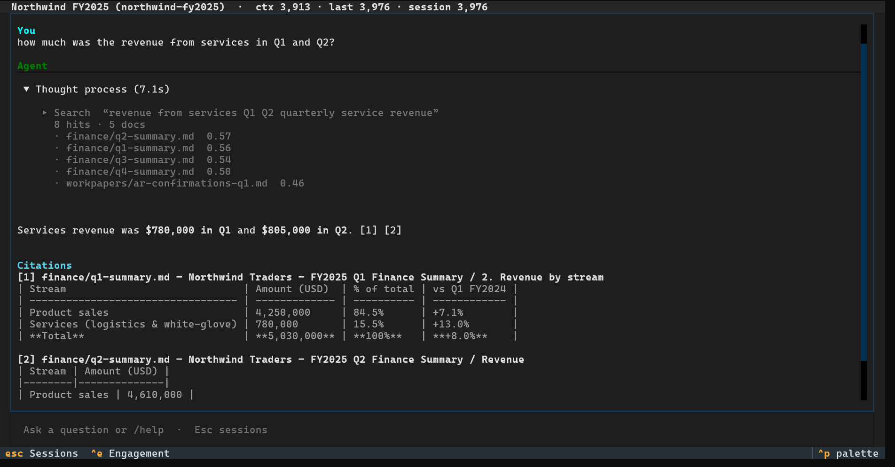

### Technikailag

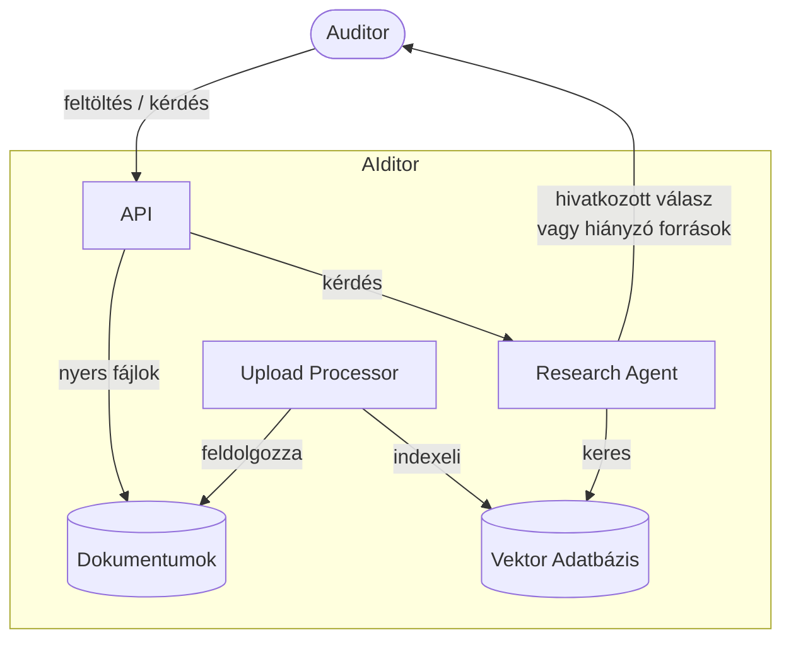

## Dependenciák

- [uv](https://docs.astral.sh/uv/)
- [just](https://github.com/casey/just)
- Python 3.13
- Docker (Compose stack)
- LLM: host [Ollama](https://ollama.com/) **vagy** OpenAI-kompatibilis API kulcs

### Hardver (lokális Ollama)

| Üzemmód                                             | Ajánlás                                                                                  |
| --------------------------------------------------- | ---------------------------------------------------------------------------------------- |
| Alapértelmezett (`qwen3.5:4b` + `nomic-embed-text`) | ~**8 GB** szabad RAM; GPU ajánlott, CPU megy, de lassú                                   |
| Kis gép (fallback chat)                             | `ollama_chat/qwen2.5:1.5b` + ugyanaz az embedding; tool-calling / válaszminőség gyengébb |
| Embed only                                          | `nomic-embed-text` ~274 MB; önmagában kevés RAM                                          |

A modellek első letöltéséhez internet kell. A lokális mód lehet lassabb és gyengébb minőségű, mint a felhős; a teljes RAG-folyamat (embedding + retrieval + válasz) API-kulcs nélkül is működik.

## Deployment

### Docker Compose

Jelenleg lokális Docker Compose deployment scriptek találhatóak a kódbázisban a [deployment/docker-compose](./deployment/docker-compose) mappában.

A használathoz, azonban segítenek a Just recipe-k:

| Parancs                | Magyarázat                              |
| ---------------------- | --------------------------------------- |
| `just compose-up`      | Build, majd stack felépítés.            |
| `just compose-down`    | Leállítás.                              |
| `just compose-clean`   | Leállítás, Docker volume-ok törlésével. |
| `just compose-restart` | Leállítás, majd felépítés.              |

> Elérhetőek fejlesztői deploymentek is, ezek pár környezeti változót másképp állítanak be, és pár portot publikussá tesznek, pl.: adatbázishoz való csatlakozáshoz. Ezekhez a `compose-` helyett `compose-dev-`-et kell írni.

A konfiguráció a [deployment/docker-compose/.env](./deployment/docker-compose/.env) fájlal lehetséges, amelyhez sablont ad a [deployment/docker-compose/.env.example](./deployment/docker-compose/.env.example). A paraméterek leírása a sablonban szerepel.

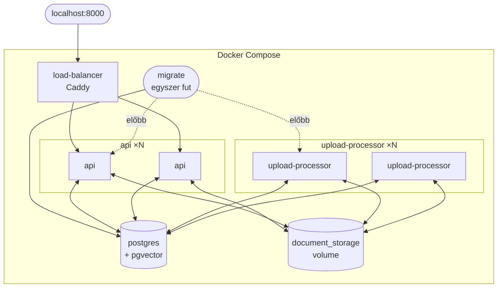

Az LLM jöhet felhő (pl.: OpenAI) vagy lokális (pl.: Ollama) szolgáltatásból is. Ezt a [deployment/docker-compose/.env](./deployment/docker-compose/.env) fájlban tudjuk konfigurálni.

OpenAI-val példa konfiguráció:

```text
LLM_MODEL=openai/gpt-6-luna
LLM_API_KEY=sk-...
LLM_API_BASE=
EMBEDDING_MODEL=openai/text-embedding-3-small
EMBEDDING_API_KEY=sk-...
EMBEDDING_API_BASE=
```

Ollama-val példa konfiguráció:

```text
LLM_MODEL=ollama_chat/qwen3.5:4b
LLM_API_KEY=
LLM_API_BASE=http://host.docker.internal:11434
EMBEDDING_MODEL=ollama/nomic-embed-text
EMBEDDING_API_KEY=
EMBEDDING_API_BASE=
```

### Cloud

Ez jelenleg **csak célterv**, nincs implementálva; a futtatható deployment a Docker Compose. Azure-ben az application logika maradna, a változás főleg új `backend.infrastructure` adapterek és konfiguráció.

A lényegi mapping:

| Lokálisan                               | Azure-ben                                                         | Mi változik                  |
| --------------------------------------- | ----------------------------------------------------------------- | ---------------------------- |
| `api` + Caddy                           | Container Apps (autoscaled, stateless)                            | gyakorlatilag semmi a kódban |
| `upload-processor` + Postgres job tábla | **Azure Service Bus** + Container Apps Jobs (KEDA, scale-to-zero) | új `JobQueue` adapter        |
| `document_storage` volume               | Azure Blob Storage                                                | új `DocumentStorage` adapter |
| Postgres + pgvector                     | Azure Database for PostgreSQL + **Azure AI Search**               | új `VectorIndex` adapter     |
| OpenAI / Ollama                         | Azure OpenAI (vagy LiteLLM-kompatibilis provider)                 | config / adapter             |
| `.env`                                  | Key Vault + managed identity                                      | config                       |
| stdout logok                            | Application Insights (OpenTelemetry)                              | exporter                     |

A jobok ma Postgres `UploadItem` sorok (`FOR UPDATE SKIP LOCKED`). Cloudban ezek **Azure Service Bus** üzenetek lennének: az API enqueue-ol, a worker a queue hosszára skálázódik, nem kell állandóan futó processor VM feltöltésenként.

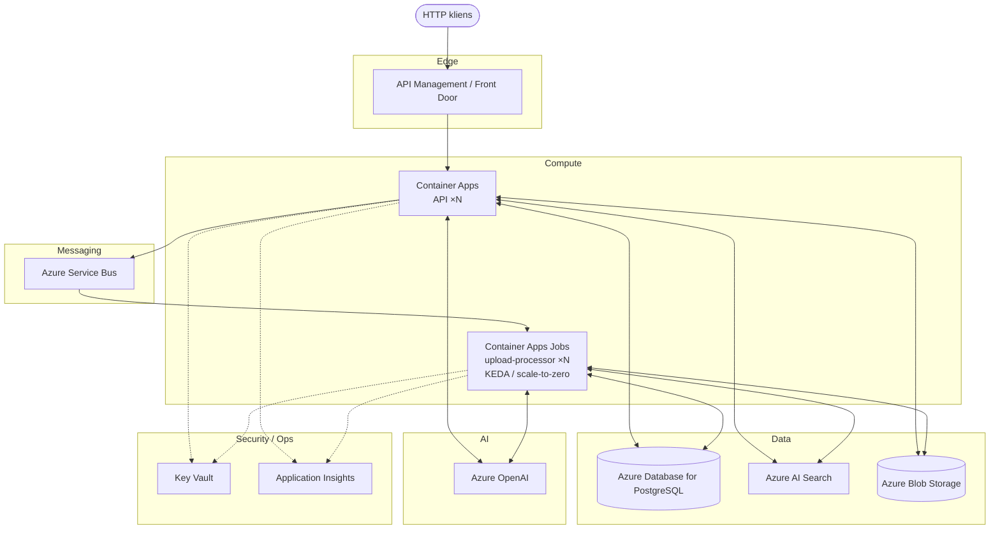

## Minta Adatok

A stack futása után a `just seed` feltölti az AI-generált, fiktív audit mintákat a [docs/samples/ai-generated/](docs/samples/ai-generated/) alól. Három Engagement jön létre (`northwind-fy2025`, `fabrikam-sox-fy2025`, `adventureworks-itgc-fy2025`); az indexelés a háttérben fut.

```bash
just seed
```

Példakérdések Engagementenként: az adott mappa `README.md`-je (pl. [northwind-fy2025](docs/samples/ai-generated/northwind-fy2025/README.md)).

### Valódi audit report (4iG)

A [docs/samples/real/4ig/](docs/samples/real/4ig/) alatt van egy nyilvános 4iG audit report PDF. Ezt a `just seed` **nem** tölti be.

```bash
aiditor engagements create --id 4ig-vmt-20240630 --name "4iG VMT 2024"
aiditor upload docs/samples/real/4ig/AGENDA_2_KVJ_4iG_VMT_20240630_signed_EN.pdf \
  --engagement 4ig-vmt-20240630 \
  --folder reports \
  --wait
```

Forrás / licenc: [docs/samples/real/4ig/LICENSE.md](docs/samples/real/4ig/LICENSE.md).

## Interfészek

A stack felhúzása után három felületen érhető el a rendszer. Mindhárom ugyanazt a REST API-t használja.

### REST API

Interaktív dokumentációk elérhetőek:


#### Életjelek
```bash
curl -s http://localhost:8000/health/live
# {"status":"ok"}

curl -s http://localhost:8000/health/ready
# {"status":"ready","checks":{"postgres":{"ok":true},"embeddings":{"ok":true}}}
```

#### RAG kérdezés
```bash
curl -s -X POST http://localhost:8000/api/v1/engagements/northwind-fy2025/ask \
  -H "Content-Type: application/json" \
  -d "{\"question\": \"What are Contoso payment terms?\"}"
```

Válasz:
```json
{
  "status": "answered",
  "answer": "Contoso’s terms are **Net-30**: payment is due within 30 days of the invoice date, by ACH or wire to the account specified on the invoice. [1]",
  "citations": [
    {
      "marker": 1,
      "chunk_id": "0f8a0aa9-959d-497e-9d2d-c01e094c14df",
      "document_id": "b7f380b8-0ae9-40c8-a99d-4554b3b8e3d4",
      "document_path": "contracts/contoso-msa.md",
      "page": null,
      "heading_path": [
        "Master Services Agreement",
        "3. Payment terms",
        "3.2 Payment due date"
      ],
      "snippet": "Payment is due within **30 days** of the invoice date (\"**Net-30**\"). Customer shall pay by ACH or wire to the account designated on the invoice.",
      "score": 0.6043246298579887
    }
  ],
  "session_id": "ac116a83-22f7-4502-a048-388f41e2a135",
  "turn_id": "badb693c-2bb1-4edd-a1fc-111c101ed8f1",
  "request_id": "4ddac7fe-6317-4cdd-8383-fc3ab0c99894",
  "usage": {
    "prompt_tokens": 5801,
    "completion_tokens": 71,
    "total_tokens": 5872
  },
  "session_total_tokens": 5872
}
```

#### Hibás / üres bemenet → 422

```bash
curl -s -X POST http://localhost:8000/api/v1/engagements/northwind-fy2025/ask \
  -H "Content-Type: application/json" \
  -d "{\"question\": \"   \"}"
```

```json
{
  "type": "https://audit-ai.local/problems/validation_error",
  "title": "Validation Error",
  "status": 422,
  "detail": "Request validation failed",
  "code": "validation_error",
  "request_id": "…"
}
```

#### Nincs releváns találat → `insufficient_evidence`

```bash
curl -s -X POST http://localhost:8000/api/v1/engagements/northwind-fy2025/ask \
  -H "Content-Type: application/json" \
  -d "{\"question\": \"What is the SOC 2 Type II opinion date for Contoso?\"}"
```

```json
{
  "status": "insufficient_evidence",
  "reason": "no_relevant_chunks",
  "suggested_client_questions": [
    {
      "question": "…",
      "rationale": "…"
    }
  ],
  "session_id": "…",
  "turn_id": "…",
  "request_id": "…"
}
```

#### Modell timeout / elérhetetlenség

A provider időtúllépése **504** `model_timeout`, az elérhetetlenség **502** `model_unavailable` (RFC7807 Problem Details, `request_id`-vel). A timeout a `MODEL_TIMEOUT_SECONDS` env-ből jön (alap: 120 s).

### CLI

Nem interaktív CLI, automatizációkhoz és AI-nak:

```bash
aiditor engagements list
aiditor --help
```

### TUI

Teljes képernyős, interaktív terminál UI az Engagement-ekhez, feltöltéshez és kérdezéshez:

```bash
aiditor-tui
```

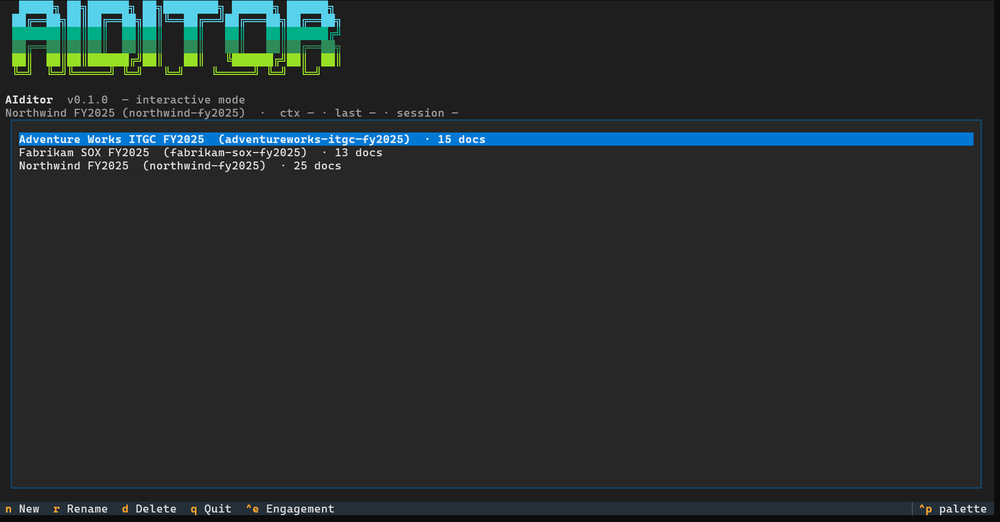

## Architektúra

### Tervezési döntések

- Single-user lokális scope → autentikáció szándékosan nincs.
- Egy image, két processz: `api` + `upload-processor` (később szétválasztható).
- Feltöltés aszinkron (`202` + háttérworker), hogy az HTTP ne várjon a parse/embedre.
- Lokálisan egy datastore: Postgres + pgvector (meta, chunk, embedding, session, job). Cloud cél: keresés leválasztása (Azure AI Search).
- Hybrid retrieval (vektor + full-text, RRF).
- Külső LLM/embedding a `ChatModel` / `Embedder` portokon + LiteLLM; provider váltás config.

### Rétegek

Az API, az alkalmazáslogika, a RAG/agent, a modell-/tárolóintegrációk és a konfiguráció szétválasztva. Az `importlinter` őrzi a határokat.

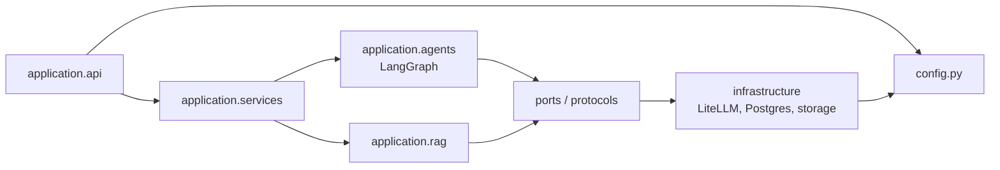

```text
services/backend/src/backend/
├── application/
│   ├── api/           # HTTP, Problem Details, health
│   ├── agents/        # Research Agent (LangGraph)
│   ├── rag/           # ingest worker, indexelés
│   ├── services/      # use-case-ek (ask, documents, …)
│   ├── repositories/  # portok
│   └── storage/       # VectorIndex, JobQueue, DocumentStorage portok
├── domain/            # entitások, hibák (nincs kifelé függés)
├── infrastructure/    # Postgres, LiteLLM/Ollama, parserek
├── config.py
└── bootstrap.py       # DI / wiring
```

### Monorepo

Monorepót választottam, mivel agentic fejlesztéshez kifejezetten jól működik, gyors dev cyclet és közös toolingot biztosít.

```text
audit-ai/
├── services/backend/     # HTTP API + upload-processor
├── cli/
├── tui/
├── deployment/
│   ├── docker-compose/
│   └── cloud/            # Azure célterv
├── specs/                # Speckit
├── docs/
├── scripts/              # pl. seed
├── justfile
└── .github/workflows/
```

### Rendszerdiagram

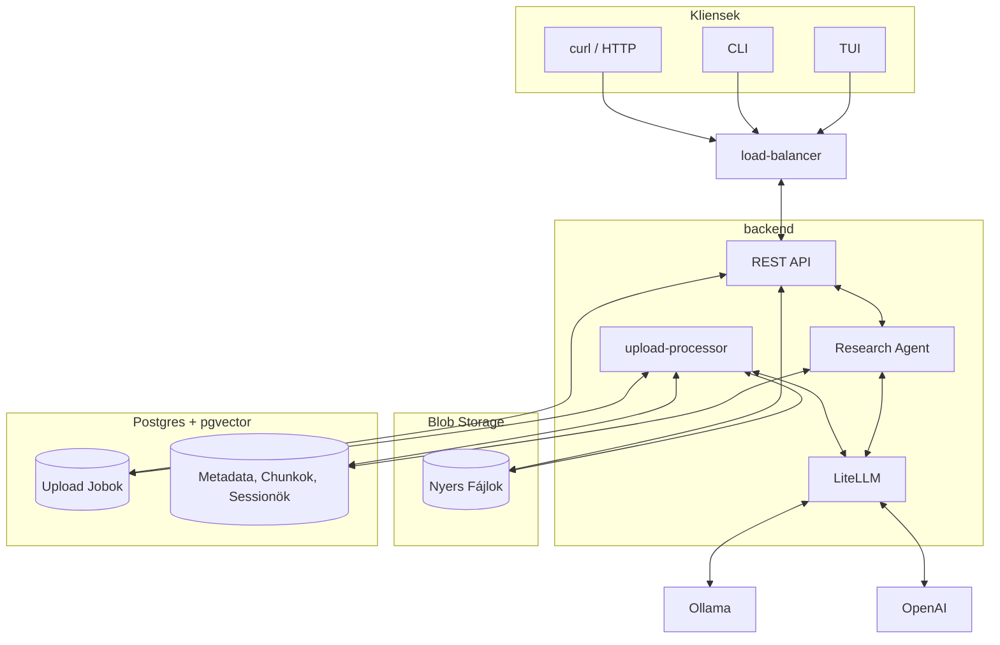

### Dokumentumfeldolgozás

A dokumentum feltöltés egy aszinkron folyamat. Az API `202`-t ad vissza, és a feldolgozás a háttérben fut. Persze le lehet az állapotát kérdezni.

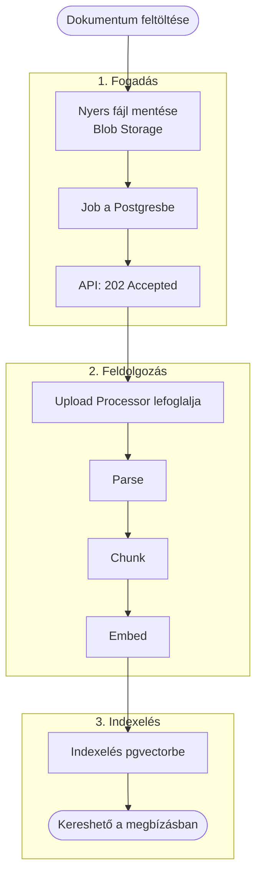

### Research Agent

Az agent az Engagement dokumentumait kutatja, majd vagy hivatkozott választ ad, vagy elmagyarázza, mi hiányzik.

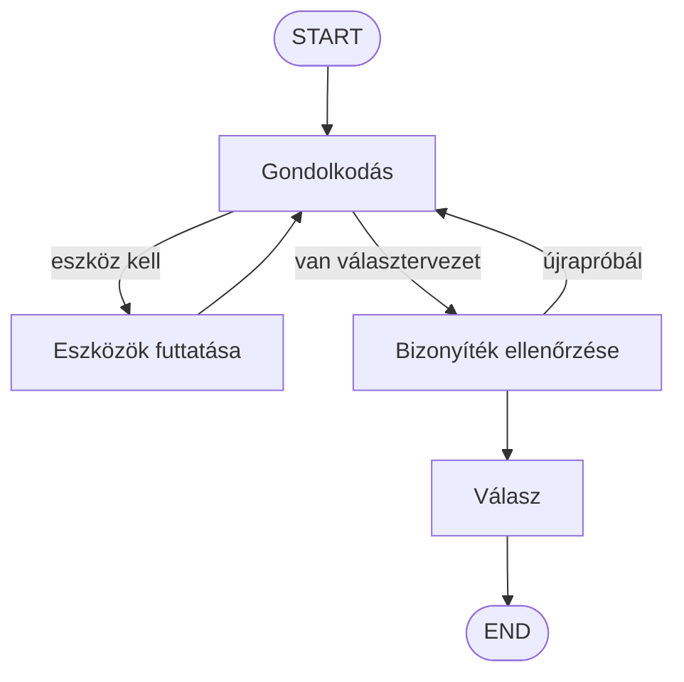

Implementáció: `services/backend/src/backend/application/agents/research_agent/graph.py`.

### Skálázódás

#### Megvalósítva most

| Téma                   | Megoldás                                                                                                                          |
| ---------------------- | --------------------------------------------------------------------------------------------------------------------------------- |
| Kérések elkülönítése   | Nincs mutable per-user state a memóriában; Session / job / meta Postgresben; Engagement-scoped retrieval; `request_id` a logokban |
| Párhuzamos végrehajtás | FastAPI async Ask; upload nem blokkolja a HTTP-t (`202` + worker); több `upload-processor` `FOR UPDATE SKIP LOCKED`-dal           |
| Erőforráskorlátok      | `MAX_CONCURRENT_MODEL_CALLS` per process; `MODEL_TIMEOUT_SECONDS`; Problem Details timeout/unavailable esetén                     |
| Több példány           | Állapotmentes `api` / worker; Caddy LB; `just compose-up` alapból 2× api + 2× worker; sticky session nem kell                     |
| Szűk keresztmetszet    | Gyakorlatban először az LLM/embedding, aztán Postgres/pgvector, csak utána érdemes tovább scale-elni                              |

```bash
docker compose -f deployment/docker-compose/compose.yaml up -d --scale upload-processor=4
docker compose -f deployment/docker-compose/compose.yaml up -d --scale api=3
docker compose -f deployment/docker-compose/compose.yaml restart load-balancer
```

#### Következő lépés (nincs a demo scope-ban)

- Job queue → Azure Service Bus + KEDA scale-to-zero
- Vektoros keresés → Azure AI Search (tranzakciós DB leválasztása)
- Rate limit / WAF az edge-en; auth (Entra ID)
- Metrikák: model latency, token usage, `insufficient_evidence` arány, queue depth — Application Insights

Részletek: [deployment/cloud/README.md](deployment/cloud/README.md).

## Minőségbiztosítás

### Lokális quality gate

```bash
just check
# opcionális: just test-db
# opcionális: RUN_INTEGRATION=1 just test-integration
```

`just check` = lint + typecheck + import-linter + **offline** unit tesztek (mockolt modell / retrieval; nincs fizetős API).

### Tesztrétegek

| Marker        | Mikor               | Példa                                                                            |
| ------------- | ------------------- | -------------------------------------------------------------------------------- |
| `unit` (alap) | CI / `just check`   | üres kérdés → 422; üres találat → insufficient; model timeout → 504; sikeres ask |
| `db`          | `just test-db`      | Postgres + pgvector testcontainers (`SKIP LOCKED`, hybrid search)                |
| `integration` | `RUN_INTEGRATION=1` | élő Ollama / OpenAI smoke                                                        |

### CI

A `.github/workflows/check.yml` path-filtereli a `backend` / `cli` / `tui` változásokat. A `main` release újrafuttatja a teljes `just check`-et.

### Import határok

Az `importlinter.ini` blokkolja az illegális importokat (domain függetlenség, application ≠ infrastructure, CLI/TUI csak HTTP).

## Naplózás

Structlog a stdout-ra (`LOG_LEVEL`, `LOG_JSON` az `.env.example`-ben). Minden HTTP válaszhoz tartozik `request_id`; a worker logok `upload_id` / job id alapján korrelálhatók. Dokumentumtartalom és API kulcsok nem mennek a logba.

## Kiberbiztonság

### Supply chain

Közvetlen függőségek minorra pinelve; 7 napos `exclude-newer` cooldown; commitolt `uv.lock`. A security-audit skill commit hash-re pinelve.

### Secret kezelés

API kulcsok `SecretStr`; `.env` gitignore-olt (csak `.env.example` a repóban).

### Biztonságos feltöltések

Zip: path escape és symlink elutasítva; fájlszám / méret / ingest representation limitek.

### Agent határok

Retrieval és toolok Engagement-scopedok; tool allowlist; `AGENT_MAX_TOOL_ROUNDS` / check restart korlát.

A lokális compose-ban **nincs** application authentication — trusted network / loopback.

## Korlátok

- Nincs user / auth / role: aki eléri az API-t, bármelyik Engagementen dolgozhat.
- Nincs OCR: scanned PDF → `not_searchable` / skipped.
- Lokális modell lassabb / gyengébb lehet; a kisebb fallback tovább rontja a tool-callingot.
- A mai tesztek a graph, retrieval és hibautak helyességét mérik, nem labelles válaszminőséget élő modellel.

## Következő lépések

### User management és authentikáció

Auditor team + ügyfélkapcsolatok; Engagement ACL; cloud cél: Entra ID. Az `insufficient_evidence` javaslatok így konkrét kapcsolattartóra címezhetők.

### OCR és több fájltípus

Scanned PDF / kép OCR; jobb representation limitek nagy táblázatokra.

### Infrastructure as code

A cloud mapping ismételhető provisioningja (Bicep / Terraform) — lásd [deployment/cloud/README.md](deployment/cloud/README.md).

### Adatbázis / keresés szétválasztása

1. Keresés leválasztása (`VectorIndex` → Azure AI Search).
2. Read replica a nehéz olvasásokhoz.
3. Connection pooling.
4. Engagement szerinti particionálás, ha kell.

Az application Protocolok miatt ez adapter-váltás, nem Ask / ingest újraírás.

### Agent válaszminőség automata tesztek

Labelles kérdéshalmaz (answered / insufficient_evidence, elvárt citation path-ek) CI-ben: grounding regresszió, hallucination detektálás.
