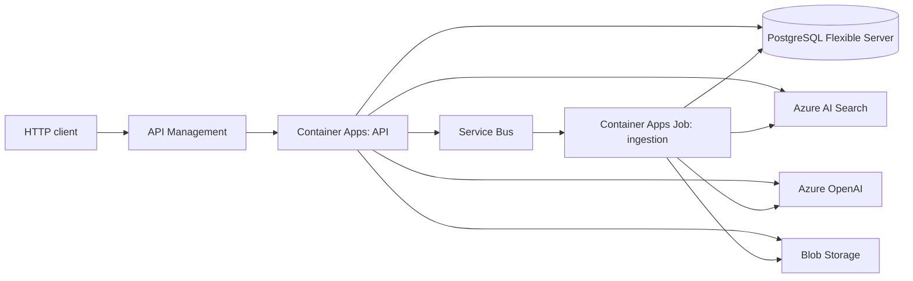

# Cloud deployment (Azure) - target design

Status: design only, not implemented. The runnable deployment is `deployment/docker-compose`.

This document describes how the Audit Assistant would run in Azure. The application code stays the same; each infrastructure concern sits behind a port in the service, so moving to the cloud means adding `backend.infrastructure` adapters and configuration, not changing the application logic.

## Component mapping

| Concern                           | Local (docker compose)                   | Azure target                                                                   | Change in the service                   |
| --------------------------------- | ---------------------------------------- | ------------------------------------------------------------------------------ | --------------------------------------- |
| API runtime                       | `backend` container                      | Azure Container Apps (autoscaled, stateless replicas)                          | None                                    |
| Ingestion worker runtime          | `worker` (same backend image)            | Container Apps Jobs, event-driven (KEDA scaling on queue length)               | None                                    |
| Metadata (engagements, documents) | PostgreSQL container                     | Azure Database for PostgreSQL Flexible Server                                  | Configuration only                      |
| Chunk search (vector + keyword)   | pgvector in the same PostgreSQL          | Azure AI Search (hybrid search, semantic ranker)                               | New `VectorIndex` adapter               |
| Document files                    | Local volume                             | Azure Blob Storage (one container per environment, engagement prefix per blob) | New `DocumentStorage` adapter           |
| LLM and embeddings                | OpenAI API or local Ollama               | Azure OpenAI (data stays in the chosen Azure region, enterprise agreements)    | New `ChatModel` and `Embedder` adapters |
| Secrets                           | `.env` file                              | Azure Key Vault + managed identity (no keys in configuration)                  | Configuration only                      |
| Ingestion queue                   | Postgres jobs table + `worker` container | Azure Service Bus + Container Apps Job workers (scaled by queue length)        | New `JobQueue` adapter                  |
| Observability                     | structlog JSON logs to stdout            | Azure Application Insights via OpenTelemetry                                   | Exporter configuration, see below       |
| Edge, rate limiting               | None                                     | Azure API Management or Front Door (quotas, WAF)                               | None                                    |
| Identity (next step)              | None                                     | Microsoft Entra ID (auditors and client contacts)                              | New auth layer, see "Next steps"        |

## Why Azure AI Search for search in the cloud

- Managed hybrid search (keyword + vector) with a semantic re-ranker. Exact terms such as invoice numbers, amounts and contract ids rank well, which pure vector search handles poorly.
- Index-level filters on engagement and folder fields keep retrieval scoped to one engagement.
- Scales independently of the transactional database. Search load from many auditors does not compete with metadata writes.
- Fits a Microsoft-centric enterprise stack (Entra ID, private endpoints, regional data residency).

Trade-off: replacing a document is no longer one database transaction. The upload worker writes the new chunks first, switches the document's active version in PostgreSQL, then deletes the old chunks from the index. Retrieval filters on the active version, so answers never mix two versions of a document.

## Request and ingestion flow

## Observability and investigations

Locally, the service writes structured JSON logs (structlog) with a `request_id`, and for background work an `upload_id` and `job_id`. In Azure this has to be wired into Application Insights so incidents can be investigated across components:

- OpenTelemetry instrumentation (Azure Monitor OpenTelemetry distro) for FastAPI, SQLAlchemy and outgoing HTTP calls, exporting traces, logs and metrics to one Application Insights resource.
- The request id is propagated as trace context into the Service Bus message, so an upload request and the worker processing it share one end-to-end trace.
- Custom metrics: model call latency and token usage, retrieval hit count, the share of `insufficient_evidence` answers, job queue depth and job failures.
- Saved KQL queries and alerts for model timeouts, provider errors (rate limits), failed jobs and growing queue age.
- Logs never contain document content or credentials, the same rule as locally.

## Networking and security

- Private endpoints for PostgreSQL, Blob Storage, AI Search, Azure OpenAI and Key Vault; no public data-plane access.
- Managed identities for the API and workers; role assignments instead of connection strings.
- Customer documents are encrypted at rest (platform-managed keys by default, customer-managed keys if required by the engagement).

## Next steps beyond the infrastructure

- User and contact management on Entra ID: auditor team members and client contacts with responsibilities. When the documents lack an answer, the assistant could address the suggested outreach to the right client contact, and access could be restricted per engagement.
- Infrastructure as code (Bicep or Terraform) for everything listed above.
